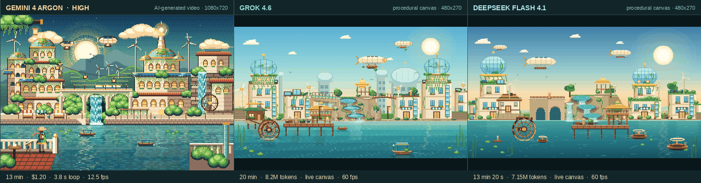
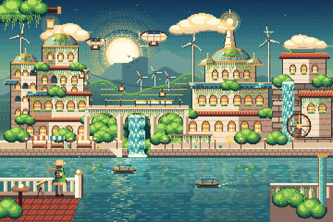
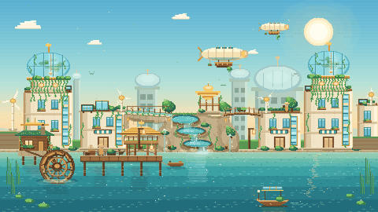
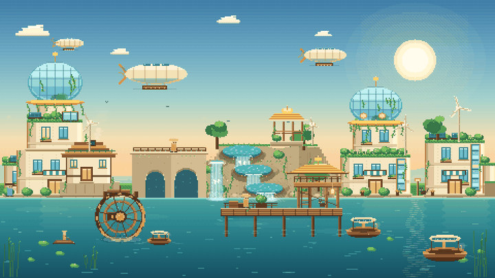

# Solarpunk Waterfront — Pixel Art Comparison

Three interpretations of the same prompt: an animated 16-bit pixel-art solarpunk
city waterfront with glass domes, cascading greenery, rooftop wind turbines,
airships, tiered waterfalls, a turning water wheel, a lookout dock and
solar-powered boats.



*Left to right: Gemini 4 Argon (high), Grok 4.6, DeepSeek Flash 4.1 — the build in
`deepseek-flash-4.1/`.*

## The prompt

> A detailed animated-style pixel-art illustration of a vibrant solarpunk city by
> a calm waterfront. Glass-domed towers draped in cascading greenery and vines,
> futuristic wind turbines gently spinning on rooftops, and sleek airships drifting
> in the warm sunny sky. Multi-tiered waterfalls pour gracefully into a wide canal
> below, where a large wooden turning water wheel operates alongside a lookout dock.
> Solar-powered wooden boats glide smoothly through the shimmering water. Cozy,
> serene, and warm atmosphere, isometric pixel art, 16-bit aesthetic, studio ghibli
> color palette, vibrant golds, blues, and greens, highly detailed environment.

## Results at a glance

| | Gemini 4 Argon (high) | Grok 4.6 | DeepSeek Flash 4.1 |
|---|---|---|---|
| Output | Pre-rendered MP4 video + poster | Single self-contained HTML canvas | Single self-contained HTML canvas |
| File | `solarpunk-city.mp4` | `index.html` (75 KB) | `deepseek-flash-4.1/index.html` (60 KB) |
| Resolution | 1080 × 720 | 480 × 270, integer-scaled | 480 × 270, integer-scaled |
| Frame rate / loop | 12.5 fps, 3.84 s loop | 60 fps, continuous | 60 fps, continuous |
| Rendering | AI-generated video frames | Procedural 2D canvas | Procedural 2D canvas |
| Assets | Video + poster PNG | None — all geometry in code | None — all geometry in code |
| Download size | 1.86 MB video | 75 KB HTML | 60 KB HTML |
| Session time | ~13 min | 20 min | ~30 min |
| Cost | $1.20 (Devin desktop, 75% Argon promo) | 8.2M tokens | Included in platform run |
| Interactivity | Video playback only | Live scene, resizes to the window | Live scene, resizes to the window |
| Mood | Dense night scene, mosaic foliage | Bright open daytime harbor | Golden-hour sunset, warm golds |
| Source of motion | Generated pixels; loops back to start | Deterministic per-pixel animation | Deterministic per-pixel animation |

Gemini reference:
https://gemini-4-argon.vercel.app/tests/gemini-4-argon-high-solarpunk-city/index.html

DeepSeek build: open `deepseek-flash-4.1/index.html`.

## What the comparison shows

**Gemini 4 Argon** produced a dense, unified night scene. The strongest part is
architectural composition: the long arched viaduct, varied rooflines, crowds of
lit windows and the mosaic-like foliage all read as one illustration. Its motion
is subtle — water shimmer, waterfall flow, turbine blades — and is baked into a
short video. It is a finished picture first and an animation second.

**Grok 4.6** produced a lighter, more open daytime scene drawn entirely at runtime.
The camera is wider, so individual props (mill, wheel, dock, boats, tiered pools)
get more breathing room but less architectural density. Every animated element is
parameterized by time: clouds drift and wrap, airships bob, turbine rotors turn at
different phases, water highlights shimmer, the water wheel rotates, boats bob, and
lanterns flicker.

**DeepSeek Flash 4.1** leans into the "warm, serene, golden hour" reading of the
prompt. The palette drops the bright midday teal for a sunset gradient — deep blue
overhead, gold at the horizon — and the canal turns a darker jade so the sun path
and lanterns carry the highlights. Composition is organised around a two-arch stone
viaduct on the left, a four-stage cascade on a rock garden in the middle, and a
long timber dock with a pagoda lookout on the right. The same code-driven animation
set is present (clouds, three airships, four turbines, 12-spoke wheel, drifting
solar boats, falling water, fireflies), but the lighting and the taller stone
architecture make it read as a different time of day rather than a re-skin.

## Feature checklist

| Feature | Gemini | Grok 4.6 | DeepSeek Flash 4.1 |
|---|---|---|---|
| Glass domes | Yes, multiple, mosaic-textured | Yes, two large domes with vine lattices | Yes, two ribbed domes with inner greenery |
| Cascading greenery / vines | Dense, covering facades | Hanging vines on towers, dome skirts, bridges | Vines on towers, dome skirts, cliff face and bridge |
| Rooftop wind turbines | Yes, several incl. skyline | Yes, four turbines with animated rotors | Yes, four turbines plus distant silhouettes |
| Airships | Yes, small, numerous | Yes, three detailed airships with solar tops | Yes, three airships with fins, gondolas and props |
| Multi-tiered waterfall | Single tall fall through arches | Three elliptical pools with stepped falls | Four-stage cascade: three pools plus a tall rock spring |
| Wooden water wheel | Yes, integrated into a building | Yes, 10-spoke wheel with paddles and splash | Yes, 12-spoke wheel, half-submerged with launder feed |
| Lookout dock | Foreground pier with figures | Elevated lookout tower, ladder, deck, cat | Long pier, pagoda lookout, ladder, cat and crates |
| Solar-powered boats | Yes, small boats on canal | Rowboat, solar-canopy boat, distant skiff | Three solar-canopy boats with pilots, wakes and lights |
| Arched stone viaduct | Yes, long multi-arch viaduct | Single stone aqueduct | Yes, two-arch viaduct carrying a water channel |
| Isometric / depth cues | Strong architectural depth | 2.5D facades, elliptical pools | 2.5D facades, elliptical pools, layered dock |
| Responsive / scalable | Letterboxed video | Integer-scaled canvas, resizes live | Integer-scaled canvas, resizes live |

## Individual loops

| Gemini 4 Argon | Grok 4.6 | DeepSeek Flash 4.1 |
|---|---|---|
|  |  |  |

## Repo layout

```
index.html                              Grok 4.6 scene
deepseek-flash-4.1/index.html           DeepSeek Flash 4.1 scene
media/comparison.gif                    Three-way animated comparison
media/comparison.png                    Still frame of the comparison
media/gemini-scene.gif                  Gemini loop, re-encoded from its MP4
media/grok46-scene.gif                  Grok 4.6 loop, captured from the canvas
media/deepseek-flash-scene.gif          DeepSeek Flash 4.1 loop, captured from the canvas
```

## Run it

Open either HTML file directly, or serve the folder:

```bash
python3 -m http.server 8000
```

Then visit `http://localhost:8000` for the Grok build or
`http://localhost:8000/deepseek-flash-4.1/` for the DeepSeek build.

## Notes on methodology

- Canvas scenes were captured from the live page at roughly 9 fps and assembled
  into the comparison GIF; the scenes themselves render at 60 fps in the browser.
- The Gemini loop was decoded from the published 12.5 fps MP4 and re-sampled to
  the same frame count so all three panels advance together.
- Timing and cost figures: Gemini on the Devin desktop app with the 75% Argon
  promo (13 min, $1.20); Grok 4.6 at 20 minutes and 8.2M tokens. DeepSeek Flash
  4.1 ran on MonkeyCode in a single interactive session (~30 min) with no
  separately metered per-run price.
- The DeepSeek scene is one file with no dependencies, fonts or image assets:
  every tower, vine, ripple and airship is drawn with rectangles and ellipses on
  a 480 × 270 canvas, then scaled with nearest-neighbour sampling.
